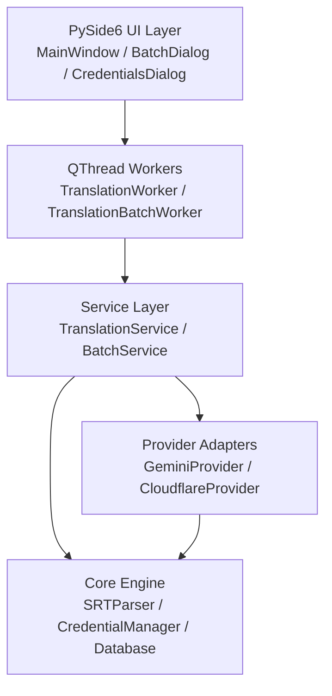

# Architecture & Technical Design

Online Subtitle Translator is structured as a decoupled, multi-tier desktop application built on Python 3 and PySide6 (Qt6).

---

## Component Roles

1. **`app.ui`**:
   - `MainWindow`: Primary interface for single file translation, real-time stage progress, and output access.
   - `BatchDialog`: Multi-subtitle queue management and folder scanning.
   - `CredentialsDialog`: Tabbed credential management for up to 10 Gemini and 10 Cloudflare accounts.

2. **`app.workers`**:
   - `TranslationWorker`: Background `QThread` ensuring smooth, non-blocking UI during network operations.
   - `TranslationBatchWorker`: Sequential batch processing worker with rate-limit signal broadcasting.

3. **`app.services`**:
   - `TranslationService`: Coordinates file validation, cue chunking, database status tracking, and atomic file saving.
   - `BatchService`: Manages queue execution, failure isolation, and directory scanning with output exclusion.

4. **`app.providers`**:
   - `GeminiTranslationProvider`: 2-layer model and account rotation adapter with `x-goog-api-key` header authentication.
   - `CloudflareTranslationProvider`: Multi-account pool adapter for Llama 3.1 8B with active account memory.

5. **`app.core`**:
   - `SRTParser`: High-tolerance SRT parsing, blank-line resilience inside dialogue, multi-encoding detection (UTF-8, cp1256, UTF-16), and atomic file writing with UTF-8 BOM.
   - `CredentialManager`: In-memory cached interface to Windows Credential Manager (DPAPI) and log redactor.
   - `Database`: SQLite storage for translation job history.
